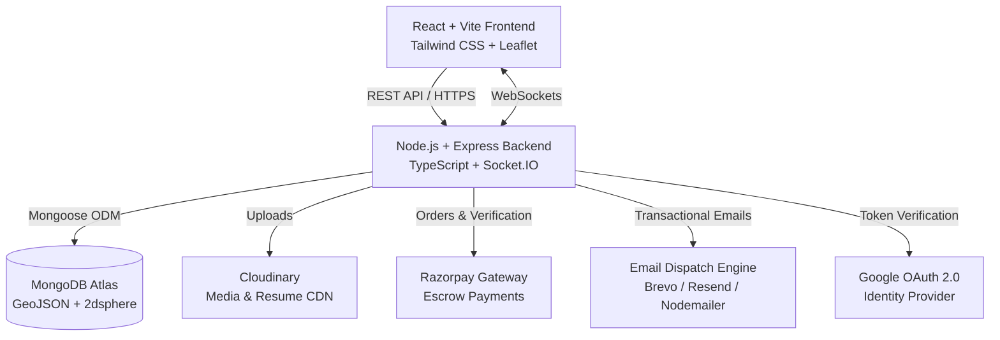

<div align="center">

# 🌐 SkillSphere

### Hyperlocal Freelance Marketplace with Real-Time Collaboration & Geospatial Matching

[](https://www.typescriptlang.org/)
[](https://react.dev/)
[](https://nodejs.org/)
[](https://expressjs.com/)
[](https://www.mongodb.com/)
[](https://tailwindcss.com/)
[](https://socket.io/)

<p align="center">
  <a href="https://skill-sphere-sage-ten.vercel.app" target="_blank"><strong>🚀 Live Demo</strong></a> •
  <a href="https://skillsphere-akgm.onrender.com" target="_blank"><strong>📡 API Endpoint</strong></a> •
  <a href="#-key-features"><strong>✨ Key Features</strong></a> •
  <a href="#-system-architecture"><strong>🏗️ Architecture</strong></a> •
  <a href="#-getting-started"><strong>🛠️ Getting Started</strong></a>
</p>

</div>

---

## 📌 Overview

**SkillSphere** is a modern, full-stack freelance platform engineered for **hyperlocal discovery**. While traditional platforms (Upwork, Fiverr) focus strictly on global remote work, SkillSphere connects clients and skilled freelancers within their local geographical radius.

By pairing **MongoDB 2dsphere geospatial indexing** with **interactive Leaflet maps**, users can discover physical or nearby opportunities, communicate in real time through **WebSockets**, manage team organizations, and process secure payments via **Razorpay escrow**.

---

## ✨ Key Features

### 📍 Hyperlocal Geospatial Matching
- **GeoJSON Point Coordinates**: Gigs and user profiles store exact longitude/latitude pairs with MongoDB `2dsphere` indexes.
- **Distance-Based Discovery**: Filter and sort gigs based on radial distance from your current GPS coordinates or custom city search.
- **Interactive Map View**: Visual exploration of available jobs and talent powered by **Leaflet** and **OpenStreetMap**.

### 👥 Dual-Role Architecture
- **Clients**: Post detailed gigs with budgets, categories, and deadlines; review applicants, accept/reject proposals, create bookings, and release payments.
- **Freelancers**: Build rich portfolios, list skills with proficiency levels, upload PDF resumes, submit custom proposals, and track completed gigs.

### 🏢 Company Workspaces & Teams
- Register organizations and manage corporate freelance accounts.
- Generate secure **team invite keys** to onboard collaborators.
- Publish company-backed gigs and manage collective contracts from a unified dashboard.

### 💬 Real-Time Communication & Notifications
- Bidirectional live chat powered by **Socket.IO** with online presence tracking.
- Message file attachments and unread message indicators.
- Instant in-app notifications for proposal acceptances, gig updates, and chat messages.

### 💳 Escrow & Payment Gateway
- Seamless checkout integrated with **Razorpay**.
- Secure order generation, server-side HMAC-SHA256 signature verification, and booking status transitions.

### 🔐 Enterprise-Grade Security & Authentication
- **Two-Factor Authentication (2FA)**: Time-based One-Time Passwords (TOTP) via **Speakeasy** with **QR Code** setup for Google Authenticator / Authy.
- **Social Login**: Google OAuth 2.0 integration for fast, one-click onboarding.
- **Access Control & Anti-Abuse**: BCrypt password hashing, JWT stateless authentication, reverse-proxy awareness (`trust proxy`), and granular route rate-limiting via `express-rate-limit`.

### 📧 Resilient Multi-Provider Email Engine
- Native support for **Brevo (Sendinblue)** and **Resend** REST APIs over HTTPS (Port 443), eliminating cloud SMTP port-blocking issues on platforms like Render.
- Automatic fallback to **Nodemailer SMTP** for local offline development.
- Built-in diagnostic routes (`/api/auth/email-status` and `/api/auth/test-email`).

### ☁️ Cloud Media & AI Processing
- Cloudinary CDN integration for fast, optimized image uploads and PDF resume storage (with automatic local disk fallback).
- Hugging Face API integration for content moderation and smart gig classification.

---

## 🏗️ System Architecture



---

## 💻 Tech Stack

| Domain | Technologies |
| :--- | :--- |
| **Frontend** | React 19, TypeScript, Vite, Tailwind CSS, Lucide Icons, React Leaflet |
| **Backend** | Node.js, Express.js, TypeScript, Socket.IO, Speakeasy, QRcode |
| **Database** | MongoDB (Mongoose ODM) with GeoJSON & 2dsphere spatial index |
| **Authentication** | JWT (JSON Web Tokens), Google OAuth 2.0, BCrypt.js, TOTP 2FA |
| **Payments** | Razorpay Node SDK (Orders, Payments, Signatures) |
| **Media Storage**| Cloudinary CDN + Multer (with local disk fallback) |
| **Email** | Brevo HTTP API, Resend HTTP API, Nodemailer SMTP |
| **Deployment** | Vercel (Frontend SPA), Render (Backend Web Service) |

---

## 📁 Project Structure

```
skillsphere/
├── client/                     # Frontend Application (React + Vite + TypeScript)
│   ├── src/
│   │   ├── components/         # Reusable UI components, Modals, Uploaders
│   │   ├── context/            # AuthContext, SocketContext
│   │   ├── pages/              # Route pages (BrowseGigs, Dashboards, 2FA, Chat)
│   │   ├── utils/              # Axios instance, helpers, formatters
│   │   └── App.tsx             # Root router configuration
│   ├── .env.example            # Client environment template
│   └── package.json
│
├── server/                     # Backend API & WebSocket Server (Node.js + Express)
│   ├── src/
│   │   ├── config/             # MongoDB database connection
│   │   ├── controllers/        # Request controllers (auth, gig, proposal, payment)
│   │   ├── middleware/         # JWT auth, rate limiter, multer upload
│   │   ├── models/             # Mongoose schemas (User, Gig, Proposal, Booking, Dispute)
│   │   ├── routes/             # Express API route declarations
│   │   ├── services/           # Email dispatch engine, moderation service
│   │   ├── socket.ts           # Socket.IO connection & event handlers
│   │   └── server.ts           # Express server entry point
│   ├── uploads/                # Local development upload directory
│   ├── .env.example            # Server environment template
│   └── package.json
│
├── .gitignore                  # Production-ready git ignore rules
└── README.md                   # Project documentation
```

---

## 🛠️ Getting Started

### Prerequisites
- **Node.js** (v18.x or newer)
- **npm** or **yarn** / **pnpm**
- **MongoDB** running locally (`mongodb://127.0.0.1:27017/skillsphere`) or a free [MongoDB Atlas](https://www.mongodb.com/atlas) connection URI.

---

### 1. Clone the Repository

```bash
git clone https://github.com/Princekr267/SkillSphere.git
cd SkillSphere
```

---

### 2. Backend Setup

1. Navigate to the server directory:
   ```bash
   cd server
   ```
2. Create your `.env` configuration file from the template:
   ```bash
   cp .env.example .env
   ```
3. Fill in the required variables in `server/.env`:
   ```env
   PORT=3001
   MONGO_URI=mongodb://127.0.0.1:27017/skillsphere
   JWT_SECRET=your_super_secret_jwt_key_here
   FRONTEND_URL=http://localhost:5173
   ```
   *(Optional third-party keys like Razorpay, Cloudinary, and Brevo can be added for full integration testing; placeholders will automatically activate local fallbacks).*

4. Install dependencies:
   ```bash
   npm install
   ```

5. Start the backend development server:
   ```bash
   npm run dev
   ```
   The backend API will run at `http://localhost:3001`.

---

### 3. Frontend Setup

1. Open a new terminal and navigate to the client directory:
   ```bash
   cd client
   ```
2. Create your `.env` configuration file from the template:
   ```bash
   cp .env.example .env
   ```
3. Ensure `client/.env` points to your backend:
   ```env
   VITE_BACKEND_URL=http://localhost:3001
   ```
4. Install dependencies:
   ```bash
   npm install
   ```
5. Start the Vite React development server:
   ```bash
   npm run dev
   ```
6. Open your browser and navigate to `http://localhost:5173`.

---

## 🔌 API Reference Overview

| Endpoint | Method | Description | Auth Required |
| :--- | :--- | :--- | :---: |
| `/api/auth/register` | `POST` | Register a new client or freelancer account | No |
| `/api/auth/login` | `POST` | Authenticate credentials & initiate 2FA if enabled | No |
| `/api/auth/google` | `POST` | Google OAuth 2.0 social sign-in/sign-up | No |
| `/api/auth/2fa/generate`| `POST` | Generate TOTP secret & QR code | Yes |
| `/api/auth/2fa/verify`  | `POST` | Verify 6-digit TOTP code during login | No (Temp Token) |
| `/api/auth/email-status`| `GET`  | Health-check active transactional email provider | No |
| `/api/gigs` | `GET` | Browse gigs with geospatial distance & keyword filters | No |
| `/api/gigs` | `POST` | Create a new gig posting | Yes (Client) |
| `/api/proposals` | `POST` | Submit a proposal on a gig | Yes (Freelancer) |
| `/api/bookings` | `POST` | Accept a proposal and initialize escrow booking | Yes (Client) |
| `/api/payments/create-order` | `POST` | Initialize Razorpay checkout order | Yes |
| `/api/companies` | `POST` | Create an organization workspace | Yes |
| `/api/companies/join` | `POST` | Join organization using invite key | Yes |
| `/api/messages/:userId` | `GET` | Retrieve chat message history with a user | Yes |

---

## 🚀 Deployment Guide

### Backend (Render)
1. Link your GitHub repository to [Render](https://render.com/).
2. Create a **Web Service** with:
   - **Root Directory**: `server`
   - **Build Command**: `npm install && npm run build`
   - **Start Command**: `npm start`
3. Add environment variables in the Render Dashboard (`MONGO_URI`, `JWT_SECRET`, `BREVO_API_KEY`, `FRONTEND_URL`, etc.).

### Frontend (Vercel)
1. Import the repository on [Vercel](https://vercel.com/).
2. Set the **Root Directory** to `client`.
3. Framework Preset: **Vite**.
4. Set Environment Variable: `VITE_BACKEND_URL=https://your-backend.onrender.com`.

---

## 📄 License

This project is licensed under the **MIT License** — see the [LICENSE](LICENSE) file for details.

---

## 👨‍💻 Author

**Prince Kumar**
- GitHub: [@Princekr267](https://github.com/Princekr267)
- Email: [princekrr267@gmail.com](mailto:princekrr267@gmail.com)

<div align="center">
  <sub>Built with ❤️ for local freelance communities. If you found this project helpful, give it a ⭐️ on GitHub!</sub>
</div>
